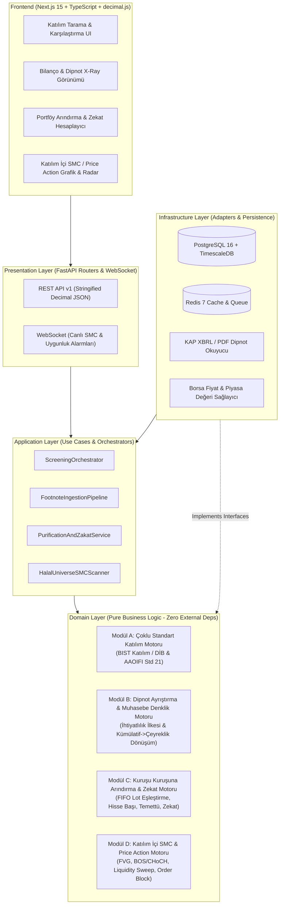
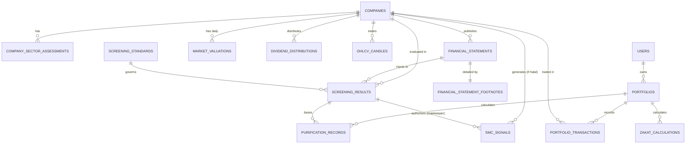
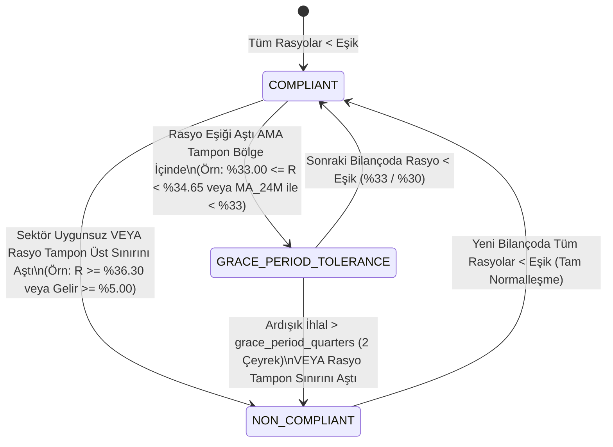

# KATILIM FİNANSMANI UYGUNLUK TARAMA (SCREENING), BİLANÇO ANALİZİ, PORTFÖY ARINDIRMA VE PİYASA TAKİP PLATFORMU — SİSTEM MİMARİSİ (`ARCHITECTURE.md`)

> [!IMPORTANT]
> **MİMARİ ANAYASA BİLDİRİMİ:** Bu belge, platformun uçtan uca sistem mimarisini, veritabanı şemasını, İslami finans (TKBB/DİB BIST Katılım ve AAOIFI) matematiksel modellerini ve API sözleşmelerini tanımlar. Geliştirme sürecindeki tüm mühendislik kararları ve yapay zeka ajanları bu belgedeki kurallara **sıfır sapma** ile uymak zorundadır.

---

## 1. MİMARİ VİZYON VE TEKNOLOJİ YIĞINI (TECH STACK)

Sistem; yüksek finansal doğruluk, denetlenebilirlik (auditability), çoklu katılım standardı desteği ve gerçek zamanlı teknik analiz taraması sağlamak üzere **Modüler Temiz Mimari (Clean Architecture) + Domain-Driven Design (DDD)** prensipleriyle tasarlanmıştır.

### 1.1. Kesinleştirilmiş Teknoloji Yığını
| Katman | Teknoloji / Kütüphane | Mimari Rolü ve Seçim Gerekçesi |
| :--- | :--- | :--- |
| **Frontend (Web & PWA)** | **Next.js 15 (App Router) + React 19 + TypeScript 5 (Strict)** | SSR/ISR ile hızlı şirket uygunluk kartları, tip güvenli istemci mimarisi. |
| **UI & Grafik Motoru** | **Tailwind CSS v4 + Shadcn/UI + TradingView Lightweight Charts** | Finansal yoğunluklu tablolar, dipnot kırılım ağaçları ve FVG/BOS/CHoCH teknik analiz çizimleri. |
| **İstemci Matematik** | **`decimal.js` (BigNumber)** | Tarayıcı tarafında portföy, lot ve arındırma önizlemelerinde `Number` (IEEE 754 float) hatalarını önlemek. |
| **Backend & API** | **Python 3.12+ / FastAPI / Pydantic v2** | Yüksek performanslı asenkron REST + WebSocket API, katı `Decimal` şema doğrulaması. |
| **ORM & Göç (Migration)** | **SQLAlchemy 2.0 (Async) + AsyncPG + Alembic** | Asenkron ilişkisel veri erişimi, tam tip korumalı (`Numeric` -> `Decimal`) sorgular. |
| **Bilanço & KAP Motoru** | **BeautifulSoup4 + lxml + PyMuPDF (`fitz`) + `pdfplumber` + Instructor (Structured LLM)** | KAP HTML/XBRL tabloları ile PDF faaliyet raporu dipnotlarını (Footnotes) ayrıştırma ve muhasebe denkliği ile doğrulama. |
| **Veritabanı** | **PostgreSQL 16 + TimescaleDB (Zaman Serisi)** | İlişkisel bilanço/portföy verileri için ACID güvencesi; OHLCV mum verileri ve tarihsel piyasa değeri serileri için TimescaleDB Hypertable. |
| **Önbellek & Kuyruk** | **Redis 7 + ARQ / Celery** | KAP bildirim dinleyicisi, periyodik SMC taramaları, 12/24 aylık hareketli ortalama piyasa değeri hesaplama işleri. |

### 1.2. Sıfır Kayan Nokta Politikası (Zero-Float Financial Precision Rule)
> [!CAUTION]
> **KESİN YASAK:** Sistemin hiçbir katmanında (Veritabanı, Python Backend, JSON serileştirme, TypeScript Frontend) parasal tutarlar, hisse pay/lot adetleri veya finansal uygunluk rasyoları için `float`, `double`, `REAL`, `DOUBLE PRECISION` veya JavaScript `number` aritmetiği **KULLANILAMAZ**.

1. **Veritabanı Katmanı (PostgreSQL):**
   - Parasal Bilanço ve Portföy Tutarları: `NUMERIC(24, 4)` (Trilyon TL ölçeğindeki bilanço kalemlerini ve kuruş altı 4 hane hassasiyeti kayıpsız tutar).
   - Birim Fiyatlar ve Temettü Tutarları: `NUMERIC(18, 6)` (Bölünme ve hisse başı net/brüt temettü hassasiyeti).
   - Hisse Pay / Lot Adetleri: `NUMERIC(20, 6)` (Bedelsiz sermaye artırımı kaynaklı küsuratlı lotlar dahil).
   - Finansal Oranlar / Rasyolar: `NUMERIC(12, 8)` (Örn: `%32,95` oranı `0.32950000` olarak saklanır; baz puanın binde biri hassasiyetindedir).
2. **Backend Katmanı (Python):**
   - Standart `decimal.Decimal` modülü kullanılır. Global context: `prec = 28`.
   - **İhtiyatlılık Yuvarlama Kuralı (Shariah Prudence Rounding):**
     - Uygunluk rasyoları (`debt_ratio`, `cash_ratio`, `impure_income_ratio`) ve Arındırma/Zekat tutarları yuvarlanırken yatırımcıyı şüpheli kazançtan korumak adına **`ROUND_HALF_UP`** (veya arındırma tutarının kuruşa tamamlanmasında **`ROUND_CEILING`**) uygulanır.
3. **API Sözleşmesi (JSON):**
   - Tüm `Decimal` alanlar JSON içinde **String** olarak (`"1450230.5000"`) taşınır; böylece `JSON.parse()` sırasında IEEE 754 hassasiyet kaybı yaşanmaz.

---

## 2. SİSTEM MİMARİSİ VE TAM KLASÖR AĞACI (DIRECTORY STRUCTURE)

Proje, bağımlılıkların dıştan içe doğru aktığı (Dependency Rule) **Monorepo Clean Architecture** yapısında kurgulanmıştır:



### 2.1. Tam Klasör Ağacı
```text
katilim-platform/
├── ARCHITECTURE.md                          # Sistem Mimarisi, Şema ve Matematiksel Anayasa
├── TODO.md                                  # 4 Fazlı Geliştirme Yol Haritası ([MODEL: FLASH/ARGON])
├── AGENT_RULES.md                           # Alt Modeller İçin Katı Kodlama ve Finans Kuralları
├── .antigravity/
│   └── rules.md                             # Antigravity Ajan Kuralları (AGENT_RULES ile senkron)
├── docker-compose.yml                       # PostgreSQL (TimescaleDB), Redis, Backend, Frontend
│
├── backend/                                 # Python 3.12 + FastAPI Backend & Finansal Motorlar
│   ├── pyproject.toml
│   ├── alembic.ini
│   ├── migrations/                          # Alembic veritabanı şema göç dosyaları
│   ├── app/
│   │   ├── main.py                          # FastAPI uygulama giriş noktası
│   │   ├── core/
│   │   │   ├── config.py                    # Ortam değişkenleri (Pydantic Settings)
│   │   │   ├── decimal_utils.py             # Decimal context, Money, Ratio, Bps yardımcı tipleri
│   │   │   ├── exceptions.py                # Domain ve uygulama hata sınıfları
│   │   │   └── security.py                  # JWT, RBAC ve denetim izi (Audit Log)
│   │   │
│   │   ├── domain/                          # ÇEKİRDEK İŞ MANTIKLARI (Saf Python, harici bağımlılık yok)
│   │   │   ├── value_objects/
│   │   │   │   ├── money.py                 # Money(amount: Decimal, currency: Currency)
│   │   │   │   ├── ratio.py                 # Ratio(value: Decimal) & BasisPoints(bps: int)
│   │   │   │   └── fiscal_period.py         # FiscalPeriod(year: int, quarter: int, days: int)
│   │   │   ├── screening/                   # MODÜL A: Çoklu Standart Katılım Motoru
│   │   │   │   ├── entities.py              # ScreeningStandard, ScreeningResult, ComplianceStatus
│   │   │   │   ├── standards_registry.py    # BIST_KATILIM (TKBB/DİB) ve AAOIFI_STD_21 kuralları
│   │   │   │   ├── sector_filter.py         # Faaliyet alanı ve ana sözleşme uygunluk denetçisi
│   │   │   │   ├── ratio_calculator.py      # Borç, Nakit ve Uygunsuz Gelir rasyo hesaplayıcı
│   │   │   │   └── grace_period_fsm.py      # Tampon bölge (Tolerance) & Hoşgörü süresi durum makinesi
│   │   │   ├── financial_parser/            # MODÜL B: Dipnot ve Bilanço Ayrıştırma Motoru
│   │   │   │   ├── entities.py              # FinancialStatement, FinancialStatementFootnotes
│   │   │   │   ├── identity_validator.py    # Muhasebe denklik kontrolü (Detay == Ana Kalem)
│   │   │   │   ├── quarter_isolator.py      # Kümülatif (6A/9A/12A) tablodan tekil çeyrek ayrıştırıcı
│   │   │   │   └── prudence_classifier.py   # Şüpheli/belirsiz kalemler için İhtiyatlılık sınıflandırıcısı
│   │   │   ├── purification_zakat/          # MODÜL C: Arındırma (Purification) ve Zekat Motoru
│   │   │   │   ├── entities.py              # HoldingLot, PurificationReport, ZakatReport
│   │   │   │   ├── fifo_lot_matcher.py      # Alım/satım işlemlerinden FIFO elde tutma günü hesaplayıcı
│   │   │   │   ├── holding_purifier.py      # Hisse başına / dönem karı bazlı arındırma motoru
│   │   │   │   ├── dividend_purifier.py     # Temettü bazlı arındırma motoru
│   │   │   │   └── zakat_calculator.py      # Ticari Emtia (%2.5) ve Zekata Tabi Dönen Varlık motoru
│   │   │   ├── smc_scanner/                 # MODÜL D: Katılım İçi Price Action / SMC Tarayıcı
│   │   │   │   ├── entities.py              # Candle, SwingPoint, FVGZone, StructureBreak, LiquidityPool
│   │   │   │   ├── halal_gatekeeper.py      # Sadece COMPLIANT hisseleri taramaya alan güvenlik kapısı
│   │   │   │   ├── swing_detector.py        # Fraktal tepe/dip (Swing High/Low) tespit algoritması
│   │   │   │   ├── fvg_detector.py          # Fair Value Gap (Adil Değer Boşluğu) & Mitigation takibi
│   │   │   │   ├── structure_analyzer.py    # BOS (Break of Structure) & CHoCH (Change of Character)
│   │   │   │   └── liquidity_detector.py    # Equal Highs/Lows (BSL/SSL) ve Liquidity Sweep tespiti
│   │   │   └── repositories/                # Soyut Repository Arayüzleri (Ports)
│   │   │       ├── company_repo.py
│   │   │       ├── financial_repo.py
│   │   │       ├── screening_repo.py
│   │   │       ├── portfolio_repo.py
│   │   │       └── market_data_repo.py
│   │   │
│   │   ├── application/                     # USE CASE & ORKESTRASYON KATMANI
│   │   │   ├── dtos/                        # Pydantic v2 Girdi/Çıktı Şemaları (Strict Decimal)
│   │   │   ├── use_cases/
│   │   │   │   ├── run_company_screening.py
│   │   │   │   ├── parse_and_verify_footnotes.py
│   │   │   │   ├── calculate_portfolio_purification.py
│   │   │   │   ├── calculate_portfolio_zakat.py
│   │   │   │   └── scan_halal_market_smc.py
│   │   │   └── services/
│   │   │       └── mcap_moving_average.py   # 12/24/36 aylık hareketli ortalama piyasa değeri servisi
│   │   │
│   │   ├── infrastructure/                  # DIŞ DÜNYA ADAPTÖRLERİ VE VERİTABANI
│   │   │   ├── database/
│   │   │   │   ├── session.py               # AsyncEngine ve SessionFactory
│   │   │   │   ├── models.py                # SQLAlchemy 2.0 ORM Modelleri (NUMERIC zorunlu)
│   │   │   │   └── repositories/            # Repository somut uygulamaları
│   │   │   ├── parsers/
│   │   │   │   ├── kap_xbrl_parser.py       # KAP HTML/XBRL ana bilanço çekici
│   │   │   │   ├── pdf_footnote_extractor.py# PDF Dipnot tablo ve metin okuyucu
│   │   │   │   └── llm_footnote_structurer.py# Dipnot metninden yapılandırılmış kalem çıkarıcı
│   │   │   ├── market_data/
│   │   │   │   └── bist_feed_adapter.py     # BIST OHLCV ve pay sayısı veri sağlayıcı adaptörü
│   │   │   └── workers/
│   │   │       └── tasks.py                 # Zamanlanmış bilanço, piyasa değeri ve SMC görevleri
│   │   │
│   │   └── presentation/                    # API KATMANI
│   │       ├── api/
│   │       │   ├── v1/
│   │       │   │   ├── companies.py
│   │       │   │   ├── screening.py
│   │       │   │   ├── financials.py
│   │       │   │   ├── portfolio.py
│   │       │   │   ├── purification_zakat.py
│   │       │   │   └── smc_scanner.py
│   │       │   └── deps.py
│   │       └── websockets/
│   │           └── alerts_ws.py
│   │
│   └── tests/                               # Birim, Entegrasyon ve Uç Durum (Edge-Case) Testleri
│       ├── unit/
│       │   ├── test_screening_engine.py
│       │   ├── test_footnote_identity.py
│       │   ├── test_purification_math.py
│       │   ├── test_zakat_math.py
│       │   └── test_smc_algorithms.py
│       └── integration/
│
└── frontend/                                # Next.js 15 + TypeScript + Tailwind CSS İstemci
    ├── package.json
    ├── tsconfig.json
    └── src/
        ├── app/                             # Next.js 15 App Router Sayfaları
        │   ├── (dashboard)/
        │   │   ├── screening/               # Çoklu standart katılım tarama tablosu
        │   │   ├── companies/[ticker]/      # Şirket X-Ray: Rasyolar, Dipnot Kırılımı, SMC Grafiği
        │   │   ├── portfolio/               # Portföy, Arındırma (Purification) ve Zekat Merkezi
        │   │   └── scanner/                 # Sadece Katılım Uygun Hisseler SMC / Price Action Radarı
        ├── components/
        │   ├── charts/                      # Lightweight Charts (FVG/BOS/CHoCH katmanlı)
        │   ├── financials/                  # Dipnot doğrulama ve bilanço kırılım bileşenleri
        │   └── purification/                # Kuruşu kuruşuna arındırma ve zekat rapor kartları
        ├── lib/
        │   ├── decimal/                     # decimal.js sarmalayıcıları ve para/oran formatlayıcılar
        │   └── api/                         # Tip güvenli API istemcisi
        └── types/                           # Backend DTO'ları ile birebir eşleşen TS tipleri
```

---

## 3. VERİTABANI ŞEMASI (ERD VE TABLO YAPILARI)

### 3.1. Varlık-İlişki Diyagramı (Entity-Relationship Diagram)



### 3.2. Detaylı Tablo Yapıları (PostgreSQL 16 + TimescaleDB DDL Spesifikasyonu)

#### Tablo 1: `screening_standards` (Katılım Standartları ve Parametrik Eşikler)
Sistemin BIST Katılım (TKBB/DİB) ve AAOIFI standartlarını kod değiştirmeden parametrik çalıştırmasını sağlar.
- `id` (`UUID`, PK, Default `gen_random_uuid()`)
- `code` (`VARCHAR(32)`, UNIQUE, NOT NULL) — Örn: `'BIST_KATILIM_DIB'`, `'AAOIFI_STD_21'`
- `name` (`VARCHAR(128)`, NOT NULL)
- `max_interest_debt_ratio` (`NUMERIC(12, 8)`, NOT NULL) — BIST için `0.33000000`, AAOIFI için `0.30000000`
- `max_interest_cash_ratio` (`NUMERIC(12, 8)`, NOT NULL) — BIST için `0.33000000`, AAOIFI için `0.30000000`
- `max_impure_income_ratio` (`NUMERIC(12, 8)`, NOT NULL) — Her iki standart için `0.05000000` (`%5`)
- `debt_denominator_rule` (`VARCHAR(32)`, NOT NULL) — `'MARKET_CAP'`, `'TOTAL_ASSETS'`, `'MAX_OF_MCAP_OR_ASSETS'`, `'MCAP_MA_24M'`
- `cash_denominator_rule` (`VARCHAR(32)`, NOT NULL) — `'MARKET_CAP'`, `'TOTAL_ASSETS'`, `'MAX_OF_MCAP_OR_ASSETS'`, `'MCAP_MA_24M'`
- `mcap_moving_avg_months` (`SMALLINT`, NOT NULL, Default `0`) — `0` (Spot), `12`, `24`, `36`
- `tolerance_band_bps` (`INTEGER`, NOT NULL, Default `150`) — Tampon bölge (Örn: `150` bps = `+%1.5` mutlak hoşgörü veya relatif `%10` aşım)
- `grace_period_quarters` (`SMALLINT`, NOT NULL, Default `2`) — Uygunluktan çıkmadan önce izin verilen ardışık çeyrek sayısı
- `exclude_defense_sector` (`BOOLEAN`, NOT NULL, Default `FALSE`) — Silah/savunma sanayii filtre opsiyonu
- `created_at` (`TIMESTAMPTZ`, NOT NULL, Default `NOW()`)

#### Tablo 2: `companies` (Şirket Ana Kartları)
- `id` (`UUID`, PK)
- `ticker` (`VARCHAR(16)`, UNIQUE, NOT NULL) — Örn: `'THYAO'`, `'ASELS'`, `'BIMAS'`
- `company_name` (`VARCHAR(255)`, NOT NULL)
- `kap_member_id` (`VARCHAR(64)`, UNIQUE, NULLABLE)
- `sector_code` (`VARCHAR(64)`, NOT NULL)
- `sub_sector_code` (`VARCHAR(64)`, NOT NULL)
- `is_financial_institution` (`BOOLEAN`, NOT NULL, Default `FALSE`)
- `is_participation_institution` (`BOOLEAN`, NOT NULL, Default `FALSE`) — Katılım bankası / katılım sigortası (Tekafül) mi?
- `incorporation_articles_compliant` (`BOOLEAN`, NOT NULL, Default `TRUE`) — Ana sözleşmede faizli faaliyet/yasaklı sektör maddesi durumu
- `is_active` (`BOOLEAN`, NOT NULL, Default `TRUE`)
- `updated_at` (`TIMESTAMPTZ`, NOT NULL)
- **İndeksler:** `idx_companies_ticker (ticker)`, `idx_companies_sector (sector_code)`

#### Tablo 3: `company_sector_assessments` (Faaliyet Alanı ve Sektör Uygunluk Denetimi)
- `id` (`UUID`, PK)
- `company_id` (`UUID`, FK -> `companies.id` ON DELETE CASCADE, NOT NULL)
- `standard_id` (`UUID`, FK -> `screening_standards.id`, NOT NULL)
- `effective_date` (`DATE`, NOT NULL)
- `has_conventional_banking` (`BOOLEAN`, NOT NULL, Default `FALSE`)
- `has_conventional_insurance` (`BOOLEAN`, NOT NULL, Default `FALSE`)
- `has_alcohol_production_or_trade` (`BOOLEAN`, NOT NULL, Default `FALSE`)
- `has_tobacco` (`BOOLEAN`, NOT NULL, Default `FALSE`)
- `has_gambling_or_betting` (`BOOLEAN`, NOT NULL, Default `FALSE`)
- `has_pork_products` (`BOOLEAN`, NOT NULL, Default `FALSE`)
- `has_weapons_or_defense` (`BOOLEAN`, NOT NULL, Default `FALSE`)
- `has_adult_entertainment_or_media` (`BOOLEAN`, NOT NULL, Default `FALSE`)
- `sector_status` (`VARCHAR(32)`, NOT NULL) — `'COMPLIANT'`, `'NON_COMPLIANT'`
- `auditor_notes` (`TEXT`, NULLABLE) — KAP Faaliyet Raporu veya Danışma Kurulu bilgi formu referansı
- **Kısıt (Constraint):** `UNIQUE(company_id, standard_id, effective_date)`

#### Tablo 4: `financial_statements` (Ana Bilanço ve Gelir Tablosu Verileri)
- `id` (`UUID`, PK)
- `company_id` (`UUID`, FK -> `companies.id` ON DELETE CASCADE, NOT NULL)
- `fiscal_year` (`SMALLINT`, NOT NULL) — Örn: `2026`
- `fiscal_quarter` (`SMALLINT`, NOT NULL, CHECK `fiscal_quarter IN (1, 2, 3, 4)`)
- `period_start_date` (`DATE`, NOT NULL)
- `period_end_date` (`DATE`, NOT NULL)
- `publication_date` (`TIMESTAMPTZ`, NOT NULL) — KAP'ta yayınlandığı an (Point-in-Time backtest ve tarama için kritik)
- `is_consolidated` (`BOOLEAN`, NOT NULL, Default `TRUE`)
- `reporting_currency` (`VARCHAR(3)`, NOT NULL, Default `'TRY'`)
- `total_shares_outstanding` (`NUMERIC(20, 6)`, NOT NULL) — Ödenmiş sermaye / toplam pay adedi
- **Bilanço Ana Kalemleri (`NUMERIC(24, 4)`):**
  - `total_assets` (`NUMERIC(24, 4)`, NOT NULL) — Toplam Varlıklar (Aktifler)
  - `current_assets` (`NUMERIC(24, 4)`, NOT NULL) — Dönen Varlıklar
  - `cash_and_cash_equivalents_total` (`NUMERIC(24, 4)`, NOT NULL) — Ana bilançodaki toplam Nakit ve Nakit Benzerleri
  - `short_term_financial_investments_total` (`NUMERIC(24, 4)`, NOT NULL) — Kısa Vadeli Finansal Yatırımlar
  - `long_term_financial_investments_total` (`NUMERIC(24, 4)`, NOT NULL) — Uzun Vadeli Finansal Yatırımlar
  - `trade_receivables_current` (`NUMERIC(24, 4)`, NOT NULL) — Kısa Vadeli Ticari Alacaklar (Zekat hesabı için)
  - `inventories` (`NUMERIC(24, 4)`, NOT NULL) — Stoklar (Zekat hesabı için)
  - `current_liabilities` (`NUMERIC(24, 4)`, NOT NULL) — Kısa Vadeli Yükümlülükler (Zekat hesabı için)
  - `short_term_borrowings_total` (`NUMERIC(24, 4)`, NOT NULL) — Kısa Vadeli Borçlanmalar
  - `long_term_borrowings_total` (`NUMERIC(24, 4)`, NOT NULL) — Uzun Vadeli Borçlanmalar
  - `lease_liabilities_total` (`NUMERIC(24, 4)`, NOT NULL, Default `0`) — TFRS 16 Kira Yükümlülükleri
  - `total_equity` (`NUMERIC(24, 4)`, NOT NULL) — Toplam Özkaynaklar
- **Gelir Tablosu Kalemleri (Tekil Çeyrek ve Kümülatif Ayrı - `NUMERIC(24, 4)`):**
  - `revenue_cumulative` (`NUMERIC(24, 4)`, NOT NULL) — Yılbaşından itibaren kümülatif hasılat
  - `revenue_isolated_quarter` (`NUMERIC(24, 4)`, NOT NULL) — Sadece ilgili 3 aylık çeyrek hasılatı
  - `revenue_ttm` (`NUMERIC(24, 4)`, NOT NULL) — Son 12 aylık (Trailing Twelve Months) toplam hasılat
  - `net_income_cumulative` (`NUMERIC(24, 4)`, NOT NULL)
  - `net_income_isolated_quarter` (`NUMERIC(24, 4)`, NOT NULL)
  - `net_income_ttm` (`NUMERIC(24, 4)`, NOT NULL)
- **İndeksler & Kısıtlar:** `UNIQUE(company_id, fiscal_year, fiscal_quarter, is_consolidated)`, `idx_fin_stmt_pub_date (company_id, publication_date DESC)`

#### Tablo 5: `financial_statement_footnotes` (MODÜL B: Dipnot Kırılım ve Ayrıştırma Tablosu)
Ana bilançoda toplu görünen kalemlerin dipnotlardan (Footnotes) ayrıştırılmış İslami finans detaylarını tutar.
- `id` (`UUID`, PK)
- `financial_statement_id` (`UUID`, UNIQUE, FK -> `financial_statements.id` ON DELETE CASCADE, NOT NULL)
- **1. Nakit ve Nakit Benzerleri Dipnot Kırılımı (`NUMERIC(24, 4)`):**
  - `cash_on_hand` (`NUMERIC(24, 4)`, NOT NULL, Default `0`) — Kasa (Helal)
  - `demand_deposits_banks` (`NUMERIC(24, 4)`, NOT NULL, Default `0`) — Vadesiz Mevduat (Helal)
  - `participation_accounts` (`NUMERIC(24, 4)`, NOT NULL, Default `0`) — Katılım Hesapları / Katılma Fonları (Helal)
  - `time_deposits_interest` (`NUMERIC(24, 4)`, NOT NULL, Default `0`) — **Vadeli (Faizli) Mevduat (UYGUNSUZ VARLIK)**
  - `reverse_repo_receivables` (`NUMERIC(24, 4)`, NOT NULL, Default `0`) — **Ters Repo Alacakları (UYGUNSUZ VARLIK)**
  - `money_market_funds_interest` (`NUMERIC(24, 4)`, NOT NULL, Default `0`) — **Faizli Para Piyasası / B Tipi Likit Fonlar (UYGUNSUZ VARLIK)**
  - `other_cash_unclassified` (`NUMERIC(24, 4)`, NOT NULL, Default `0`) — Dipnotta detayı verilmeyen nakit (İhtiyatlılık kuralına tabi)
- **2. Finansal Yatırımlar Dipnot Kırılımı (`NUMERIC(24, 4)`):**
  - `sukuk_and_lease_certificates` (`NUMERIC(24, 4)`, NOT NULL, Default `0`) — Kira Sertifikaları / Sukuk (Helal)
  - `compliant_equity_investments` (`NUMERIC(24, 4)`, NOT NULL, Default `0`) — Katılım uygun hisse/fon yatırımları (Helal)
  - `government_bonds_and_tbills` (`NUMERIC(24, 4)`, NOT NULL, Default `0`) — **Devlet Tahvili / Hazine Bonosu / Eurobond (UYGUNSUZ VARLIK)**
  - `corporate_bonds_interest` (`NUMERIC(24, 4)`, NOT NULL, Default `0`) — **Özel Sektör Faizli Tahvil/Bonoları (UYGUNSUZ VARLIK)**
  - `derivative_assets_speculative` (`NUMERIC(24, 4)`, NOT NULL, Default `0`) — **Türev Araçlar (UYGUNSUZ VARLIK)**
- **3. Finansal Borçlar Dipnot Kırılımı (`NUMERIC(24, 4)`):**
  - `participation_bank_financings` (`NUMERIC(24, 4)`, NOT NULL, Default `0`) — Katılım bankası fon kullanımları (Murabaha, İcara) (Faizsiz Borç)
  - `sukuk_issued_liabilities` (`NUMERIC(24, 4)`, NOT NULL, Default `0`) — İhraç edilen kira sertifikaları (Faizsiz Borç)
  - `operational_lease_tfrs16` (`NUMERIC(24, 4)`, NOT NULL, Default `0`) — TFRS 16 faaliyet kiralaması yükümlülükleri
  - `conventional_bank_loans` (`NUMERIC(24, 4)`, NOT NULL, Default `0`) — **Klasik Banka Faizli Kredileri (FAİZLİ BORÇ)**
  - `issued_bonds_and_bills_debt` (`NUMERIC(24, 4)`, NOT NULL, Default `0`) — **İhraç Edilen Faizli Tahvil/Bonolar (FAİZLİ BORÇ)**
  - `factoring_and_financial_lease_debt` (`NUMERIC(24, 4)`, NOT NULL, Default `0`) — **Faktoring ve Faizli Finansal Kiralama Borçları (FAİZLİ BORÇ)**
- **4. Gelir Tablosu Dipnot Kırılımı (Tekil Çeyrek ve TTM - `NUMERIC(24, 4)`):**
  - `interest_income_quarter` (`NUMERIC(24, 4)`, NOT NULL, Default `0`) — **Mevduat/Tahvil/Repo Faiz Geliri - Tekil Çeyrek (UYGUNSUZ GELİR)**
  - `interest_income_ttm` (`NUMERIC(24, 4)`, NOT NULL, Default `0`) — **Faiz Geliri - Son 12 Ay (UYGUNSUZ GELİR)**
  - `participation_profit_share_income_quarter` (`NUMERIC(24, 4)`, NOT NULL, Default `0`) — Katılım hesabı / Sukuk kar payı geliri (Helal)
  - `participation_profit_share_income_ttm` (`NUMERIC(24, 4)`, NOT NULL, Default `0`)
  - `fx_gain_operating_quarter` (`NUMERIC(24, 4)`, NOT NULL, Default `0`) — Ticari faaliyet kaynaklı kur farkı geliri (Helal)
  - `fx_gain_interest_bearing_quarter` (`NUMERIC(24, 4)`, NOT NULL, Default `0`) — **Faizli döviz mevduatı/tahvili kaynaklı kur farkı (İhtiyatlılık parametresine bağlı)**
  - `non_compliant_side_income_quarter` (`NUMERIC(24, 4)`, NOT NULL, Default `0`) — **Uygunsuz yan faaliyet gelirleri (Örn: otel/perakende içinde alkol/faizli komisyon yan geliri) - Tekil Çeyrek**
  - `non_compliant_side_income_ttm` (`NUMERIC(24, 4)`, NOT NULL, Default `0`) — **Uygunsuz yan faaliyet gelirleri - Son 12 Ay**
- **5. Denetim ve Doğrulama Meta Verileri:**
  - `cash_footnote_refs` (`JSONB`, NOT NULL) — Örn: `{"note_no": "Dipnot 4", "page": 32, "raw_table_hash": "..."}`
  - `debt_footnote_refs` (`JSONB`, NOT NULL)
  - `income_footnote_refs` (`JSONB`, NOT NULL)
  - `is_accounting_identity_verified` (`BOOLEAN`, NOT NULL) — Alt kalemlerin toplamı ana bilanço kalemine kuruşu kuruşuna eşit mi?
  - `used_conservative_fallback` (`BOOLEAN`, NOT NULL, Default `FALSE`) — Dipnot eksikliği nedeniyle İhtiyatlılık İlkesi devreye girdi mi?
  - `extraction_method` (`VARCHAR(32)`, NOT NULL) — `'KAP_XBRL_STRUCTURED'`, `'PDF_PARSER_VERIFIED'`, `'HUMAN_AUDITOR_APPROVED'`

#### Tablo 6: `market_valuations` (Piyasa Değeri ve Hareketli Ortalama Zaman Serisi)
- `company_id` (`UUID`, FK -> `companies.id`, NOT NULL)
- `valuation_date` (`DATE`, NOT NULL)
- `close_price` (`NUMERIC(18, 6)`, NOT NULL)
- `shares_outstanding` (`NUMERIC(20, 6)`, NOT NULL)
- `spot_market_cap` (`NUMERIC(24, 4)`, NOT NULL) — `close_price * shares_outstanding`
- `mcap_ma_12m` (`NUMERIC(24, 4)`, NULLABLE) — Son 252 işlem günü (12 ay) aritmetik ortalama piyasa değeri
- `mcap_ma_24m` (`NUMERIC(24, 4)`, NULLABLE) — Son 504 işlem günü (24 ay) aritmetik ortalama piyasa değeri
- `mcap_ma_36m` (`NUMERIC(24, 4)`, NULLABLE) — Son 756 işlem günü (36 ay) aritmetik ortalama piyasa değeri
- **PK:** `(company_id, valuation_date)` (TimescaleDB Hypertable olarak bölümlendirilir).

#### Tablo 7: `screening_results` (Çoklu Standart Tarama ve Uygunluk Sonuçları)
- `id` (`UUID`, PK)
- `company_id` (`UUID`, FK -> `companies.id`, NOT NULL)
- `financial_statement_id` (`UUID`, FK -> `financial_statements.id`, NOT NULL)
- `standard_id` (`UUID`, FK -> `screening_standards.id`, NOT NULL)
- `valuation_date` (`DATE`, NOT NULL)
- `denominator_value_used` (`NUMERIC(24, 4)`, NOT NULL) — Hesaplamada baz alınan payda (Spot MCAP, MA24M MCAP veya Toplam Varlıklar)
- `interest_debt_numerator` (`NUMERIC(24, 4)`, NOT NULL)
- `interest_debt_ratio` (`NUMERIC(12, 8)`, NOT NULL) — Örn: `0.24150000` (`%24.15`)
- `is_debt_ratio_compliant` (`BOOLEAN`, NOT NULL)
- `interest_cash_numerator` (`NUMERIC(24, 4)`, NOT NULL)
- `interest_cash_ratio` (`NUMERIC(12, 8)`, NOT NULL)
- `is_cash_ratio_compliant` (`BOOLEAN`, NOT NULL)
- `impure_income_numerator` (`NUMERIC(24, 4)`, NOT NULL)
- `total_revenue_denominator` (`NUMERIC(24, 4)`, NOT NULL)
- `impure_income_ratio` (`NUMERIC(12, 8)`, NOT NULL) — Örn: `0.01850000` (`%1.85`)
- `is_impure_income_compliant` (`BOOLEAN`, NOT NULL)
- `is_sector_compliant` (`BOOLEAN`, NOT NULL)
- `overall_status` (`VARCHAR(32)`, NOT NULL) — `'COMPLIANT'`, `'GRACE_PERIOD_TOLERANCE'`, `'NON_COMPLIANT'`, `'INSUFFICIENT_DATA'`
- `consecutive_breach_quarters` (`SMALLINT`, NOT NULL, Default `0`)
- `purification_per_share_quarter` (`NUMERIC(18, 8)`, NOT NULL) — Tekil çeyrek için hisse başına düşen toplam uygunsuz gelir (TL)
- `purification_ratio_dividend` (`NUMERIC(12, 8)`, NOT NULL) — Temettü arındırması için `Toplam Uygunsuz Gelir / Toplam Hasılat` oranı
- `zatable_net_assets_per_share` (`NUMERIC(18, 8)`, NOT NULL) — Uzun vadeli zekat için hisse başına zekata tabi net dönen varlık (TL)
- `calculated_at` (`TIMESTAMPTZ`, NOT NULL, Default `NOW()`)
- **İndeksler:** `idx_screening_lookup (company_id, standard_id, valuation_date DESC)`, `idx_screening_halal_pool (standard_id, overall_status) WHERE overall_status IN ('COMPLIANT', 'GRACE_PERIOD_TOLERANCE')`

#### Tablo 8: `portfolios` ve `portfolio_transactions` (Portföy ve FIFO İşlem Defteri)
- **`portfolios`:**
  - `id` (`UUID`, PK)
  - `user_id` (`UUID`, NOT NULL)
  - `name` (`VARCHAR(128)`, NOT NULL)
  - `preferred_standard_id` (`UUID`, FK -> `screening_standards.id`, NOT NULL)
  - `default_investment_intent` (`VARCHAR(32)`, NOT NULL) — `'TRADING_SHORT_TERM'` (Al-Sat / Ticari Emtia) veya `'LONG_TERM_DIVIDEND'` (Uzun Vadeli Temettü/Ortaklık)
- **`portfolio_transactions`:**
  - `id` (`UUID`, PK)
  - `portfolio_id` (`UUID`, FK -> `portfolios.id` ON DELETE CASCADE, NOT NULL)
  - `company_id` (`UUID`, FK -> `companies.id`, NOT NULL)
  - `transaction_type` (`VARCHAR(16)`, NOT NULL) — `'BUY'`, `'SELL'`, `'BONUS_ISSUE'`, `'RIGHTS_ISSUE'`
  - `transaction_date` (`DATE`, NOT NULL)
  - `quantity_lots` (`NUMERIC(20, 6)`, NOT NULL)
  - `unit_price` (`NUMERIC(18, 6)`, NOT NULL)
  - `investment_intent_override` (`VARCHAR(32)`, NULLABLE) — Hisse bazında niyet ayrımı (`'TRADING_SHORT_TERM'` vs `'LONG_TERM_DIVIDEND'`)

#### Tablo 9: `dividend_distributions`, `purification_records` ve `zakat_calculations`
- **`dividend_distributions`:**
  - `id` (`UUID`, PK), `company_id` (`UUID`, FK), `ex_dividend_date` (`DATE`), `source_fiscal_year` (`SMALLINT`), `gross_dividend_per_share` (`NUMERIC(18, 6)`), `net_dividend_per_share` (`NUMERIC(18, 6)`)
- **`purification_records`:**
  - `id` (`UUID`, PK), `portfolio_id` (`UUID`, FK), `company_id` (`UUID`, FK), `screening_result_id` (`UUID`, FK), `method` (`VARCHAR(32)` — `'HOLDING_PERIOD_PRO_RATA'` veya `'DIVIDEND_BASED'`), `period_days` (`SMALLINT`), `weighted_held_days` (`NUMERIC(10, 4)`), `effective_quantity_lots` (`NUMERIC(20, 6)`), `calculated_purification_amount` (`NUMERIC(24, 4)`), `is_donated` (`BOOLEAN`, Default `FALSE`)
- **`zakat_calculations`:**
  - `id` (`UUID`, PK), `portfolio_id` (`UUID`, FK), `zakat_valuation_date` (`DATE`), `calendar_basis` (`VARCHAR(16)` — `'HIJRI_354'` [`%2.5`] veya `'GREGORIAN_365'` [`%2.577`]), `gold_85g_nisab_try` (`NUMERIC(24, 4)`), `total_trading_intent_value` (`NUMERIC(24, 4)`), `total_long_term_zatable_value` (`NUMERIC(24, 4)`), `total_zakat_due` (`NUMERIC(24, 4)`), `breakdown_json` (`JSONB`)

#### Tablo 10: `ohlcv_candles` ve `smc_signals` (MODÜL D: Katılım İçi Teknik Analiz)
- **`ohlcv_candles` (TimescaleDB Hypertable):**
  - `company_id` (`UUID`, FK), `timeframe` (`VARCHAR(8)` — `'15m'`, `'1h'`, `'4h'`, `'1d'`, `'1w'`), `bucket_time` (`TIMESTAMPTZ`), `open` (`NUMERIC(18, 6)`), `high` (`NUMERIC(18, 6)`), `low` (`NUMERIC(18, 6)`), `close` (`NUMERIC(18, 6)`), `volume` (`NUMERIC(24, 4)`)
  - **PK:** `(company_id, timeframe, bucket_time)`
- **`smc_signals`:**
  - `id` (`UUID`, PK)
  - `company_id` (`UUID`, FK -> `companies.id`, NOT NULL)
  - `screening_result_id` (`UUID`, FK -> `screening_results.id`, NOT NULL) — **Zorunlu FK: Uygunluk kanıtı olmadan sinyal üretilemez!**
  - `timeframe` (`VARCHAR(8)`, NOT NULL)
  - `signal_type` (`VARCHAR(32)`, NOT NULL) — `'BULLISH_FVG'`, `'BEARISH_FVG'`, `'BULLISH_BOS'`, `'BEARISH_BOS'`, `'BULLISH_CHOCH'`, `'BEARISH_CHOCH'`, `'SSL_LIQUIDITY_SWEEP'`, `'BSL_LIQUIDITY_SWEEP'`, `'BULLISH_ORDER_BLOCK'`
  - `signal_timestamp` (`TIMESTAMPTZ`, NOT NULL)
  - `zone_upper_bound` (`NUMERIC(18, 6)`, NOT NULL)
  - `zone_lower_bound` (`NUMERIC(18, 6)`, NOT NULL)
  - `reference_swing_price` (`NUMERIC(18, 6)`, NULLABLE)
  - `is_mitigated` (`BOOLEAN`, NOT NULL, Default `FALSE`)
  - `mitigated_at` (`TIMESTAMPTZ`, NULLABLE)
  - `metadata_json` (`JSONB`, NOT NULL) — ATR çarpanı, hacim anomalisi, R:R oranı

---

## 4. ÇEKİRDEK İŞ MANTIKLARI VE MATEMATİKSEL MOTOR SPESİFİKASYONLARI

### 4.1. MODÜL A: Çoklu Standart Katılım Uygunluk Motoru (Screening Engine)

#### 4.1.1. Standartlar Karşılaştırma ve Parametre Matrisi
| Kriter | BIST Katılım Endeksi (TKBB / DİB Standartları) | Uluslararası AAOIFI (Shariah Standard No. 21) |
| :--- | :--- | :--- |
| **1. Sektör Filtresi** | Faizli bankacılık, sigorta, finansal kiralama, faktoring, alkol, tütün, kumar, domuz ürünleri, silah/savunma (DİB/TKBB kuralına göre parametrik), medya/eğlence (uygunsuz içerik). | Aynı yasaklı sektörler + silah/savunma sanayii konusunda kurumsal komite parametresi (`exclude_defense_sector`). |
| **2. Faizli Borç Rasyosu** | `< %33` (`0.33000000`) | `< %30` (`0.30000000`) |
| **3. Faizli Nakit ve Varlık Rasyosu** | `< %33` (`0.33000000`) | `< %30` (`0.30000000`) |
| **4. Uygun Olmayan Gelir Rasyosu** | `< %5` (`0.05000000`) | `< %5` (`0.05000000`) |
| **5. Rasyo Paydası ($D$)** | $\max(\text{Toplam Varlıklar}, \text{Piyasa Değeri})$ veya seçilen Hareketli Ortalama Piyasa Değeri. | Toplam Piyasa Değeri (Market Cap) veya 12/24 Aylık Hareketli Ortalama Piyasa Değeri. |

#### 4.1.2. Matematiksel Formüller
Payda ($D_{\text{base}}$) seçimi parametrik kurala göre belirlenir:
$$D_{\text{base}} = \begin{cases} 
\text{MCAP}_{\text{spot}} & \text{eğer kural } = \text{SPOT\_MCAP} \\
\frac{1}{N}\sum_{t=1}^{N} \text{MCAP}_{t} & \text{eğer kural } = \text{MCAP\_MA\_12M / 24M} \\
\max\left(\text{Total Assets}, \text{MCAP}_{\text{MA}}\right) & \text{eğer kural } = \text{MAX\_OF\_MCAP\_OR\_ASSETS}
\end{cases}$$

1. **Faizli Borç Oranı ($R_{\text{debt}}$):**
   $$R_{\text{debt}} = \frac{\text{Klasik Banka Kredileri} + \text{İhraç Edilen Faizli Tahvil/Bono} + \text{Faktoring ve Faizli Kiralama Borçları}}{D_{\text{base}}}$$
   > *Not:* Dipnotlarda açıkça tevsik edilen **Katılım Bankası Fon Kullanımları (Murabaha/İcara)** ve **Kira Sertifikası (Sukuk) İhraçları** pay kısmına (`numerator`) **dahil edilmez**.

2. **Faizli Varlık Oranı ($R_{\text{cash}}$):**
   $$R_{\text{cash}} = \frac{\text{Vadeli Mevduat} + \text{Ters Repo} + \text{Faizli Fonlar} + \text{Devlet Tahvili/Bono/Eurobond} + \text{Özel Sektör Tahvili} + \text{Sınıflanamayan Şüpheli Nakit}}{D_{\text{base}}}$$
   > *Not:* **Kasa**, **Vadesiz Mevduat**, **Katılım Hesapları** ve **Kira Sertifikaları (Sukuk)** pay kısmına **dahil edilmez**.

3. **Uygun Olmayan Gelir Oranı ($R_{\text{income}}$):**
   $$R_{\text{income}} = \frac{\text{Faiz Gelirleri}_{\text{TTM}} + \text{Uygunsuz Yan Faaliyet Gelirleri}_{\text{TTM}} + \text{Faizli Varlık Kur Farkı Geliri}_{\text{TTM}}}{\text{Toplam Hasılat}_{\text{TTM}}}$$

#### 4.1.3. Uç Durum (Edge-Case): Piyasa Değeri Çöküşü ve Tampon Bölge (Grace Period FSM)
Borsa İstanbul'da yaşanan sert endeks düşüşlerinde şirketin bilançosu değişmediği halde payda ($\text{MCAP}_{\text{spot}}$) küçüldüğü için $R_{\text{debt}}$ veya $R_{\text{cash}}$ geçici olarak `%33` (veya `%30`) sınırını aşabilir. Bunu yönetmek için **2 Katmanlı Koruma Mekanizması** uygulanır:



- **Kural 1 (Hareketli Ortalama Payda Koruması):** `mcap_moving_avg_months = 24` aktif edildiğinde, günlük çöküşler 504 işlem gününe yayıldığı için yapay rasyo patlamaları engellenir.
- **Kural 2 (Tampon Bölge / Tolerance Band):** Önceki dönemde `COMPLIANT` olan bir şirketin borç/nakit rasyosu eşik değeri ($T$, örn. `0.33`) aştığında, eğer:
  $$T \le R < T + \Delta_{\text{tolerance}} \quad (\text{Örn: } 0.33000000 \le R < 0.34500000)$$
  ise şirket doğrudan `NON_COMPLIANT` yapılmaz; `GRACE_PERIOD_TOLERANCE` statüsüne alınır ve `consecutive_breach_quarters` sayacı `1` artırılır. Yatırımcıya **"Hoşgörü Süresinde (1/2 Çeyrek) - İzlemede"** uyarısı verilir.
- **Kesin Kırmızı Çizgi:** Uygun olmayan gelir oranı ($R_{\text{income}} \ge 0.05000000$) ve Sektör Filtresi için hoşgörü (tolerance) **uygulanmaz**; `%5.00` aşımı anında `NON_COMPLIANT` üretir.

---

### 4.2. MODÜL B: Dipnot ve Bilanço Ayrıştırma Motoru (KAP & PDF Footnote Parser)

Türkiye'deki TMS/TFRS finansal tablolarında **"Nakit ve Nakit Benzerleri"** satırı tek bir sayı olarak görünür. Ancak detaylar **Dipnot 3 / Dipnot 4 (Nakit ve Nakit Benzerleri)**, **Dipnot 5/6 (Finansal Yatırımlar ve Borçlanmalar)** ve **Dipnot 20/21 (Esas Faaliyet Dışı Finansman Gelir/Giderleri)** içinde yer alır.

#### 4.2.1. Muhasebe Denklik Kısıtı (Accounting Identity Verification)
Ayrıştırma motoru (`identity_validator.py`), dipnottan okunan alt kalemlerin toplamını ana bilançodaki toplam kalemle karşılaştırır:
$$\Delta_{\text{cash}} = \text{Ana Bilanço Nakit Toplamı} - \left( \text{Kasa} + \text{Vadesiz} + \text{Katılım Hesabı} + \text{Vadeli Mevduat} + \text{Ters Repo} + \text{Diğer} \right)$$
- **Durum 1 ($\Delta_{\text{cash}} == 0$):** `is_accounting_identity_verified = True`.
- **Durum 2 ($\Delta_{\text{cash}} > 0$):** Dipnotta açıklanmayan fark ($\Delta_{\text{cash}}$), **İhtiyatlılık İlkesi (Shariah Prudence Principle)** gereği otomatik olarak `other_cash_unclassified` alanına yazılır ve rasyo hesabında **Faizli/Uygunsuz Varlık** olarak paya eklenir (`used_conservative_fallback = True`).
- **Durum 3 ($\Delta_{\text{cash}} < 0$):** Ayrıştırma hatası (OCR/Tablo kayması) vardır; kayıt `EXTRACTION_CONFLICT` olarak işaretlenir ve denetçi onay kuyruğuna düşer.

#### 4.2.2. Kümülatif Gelir Tablosundan Tekil Çeyrek (Isolated Quarter) Ayrıştırma
KAP'ta açıklanan gelir tabloları yıl içi kümülatiftir (Q1 = 3 Aylık, Q2 = 6 Aylık, Q3 = 9 Aylık, Q4 = 12 Aylık). Dönem bazlı arındırma ve TTM (Son 12 Ay) hesabı için motor şu dönüşümü zorunlu olarak yapar:
$$I_{\text{isolated}}(Y, Q) = \begin{cases} 
I_{\text{cumulative}}(Y, 1) & \text{eğer } Q = 1 \\
I_{\text{cumulative}}(Y, Q) - I_{\text{cumulative}}(Y, Q-1) & \text{eğer } Q \in \{2, 3, 4\}
\end{cases}$$
$$I_{\text{TTM}}(Y, Q) = I_{\text{cumulative}}(Y, Q) + I_{\text{cumulative}}(Y-1, 4) - I_{\text{cumulative}}(Y-1, Q)$$
> [!WARNING]
> **TMS 29 Enflasyon Muhasebesi Uç Durumu:** Şirket TMS 29 kapsamında önceki çeyrek verisini endeksleyerek revize ettiyse, çıkarma işleminde bir önceki çeyreğin tarihsel bildirimi değil, mevcut çeyrek raporundaki **"Cari Dönem (Üç Aylık)"** sütunu doğrudan okunur.

---

### 4.3. MODÜL C: Kuruşu Kuruşuna Arındırma (Purification) ve Zekat Motoru

#### 4.3.1. Yöntem 1: Hisse Başına / Dönem Bazlı Arındırma (Holding Period Pro-Rata)
Şirket temettü dağıtmasa bile, şirketin elde ettiği uygunsuz gelirden yatırımcının payına düşen kısmın elde tutulan gün sayısıyla orantılı olarak arındırılmasıdır:

1. **Hisse Başına Uygunsuz Gelir ($P_{\text{share}}$):**
   $$P_{\text{share}} = \frac{I_{\text{impure, isolated\_quarter}}}{N_{\text{shares\_outstanding}}}$$
2. **FIFO Lot Eşleştirme ve Gün Hesabı:**
   Yatırımcının ilgili bilanço çeyreği $[t_{\text{start}}, t_{\text{end}}]$ ($D_{\text{period}} \in \{90, 91, 92\}$ gün) içindeki her bir aktif lot dilimi $k \in \{1 \dots m\}$ için elde tutulan gün sayısı:
   $$D_{\text{held}, k} = \left( \min(t_{\text{sell}, k}, t_{\text{end}}) - \max(t_{\text{buy}, k}, t_{\text{start}}) \right) + 1$$
3. **Toplam Dönemlik Arındırma Tutarı ($P_{\text{total}}$):**
   $$P_{\text{total}} = \sum_{k=1}^{m} \left( P_{\text{share}} \times Q_{\text{lots}, k} \times \frac{\text{Decimal}(D_{\text{held}, k})}{\text{Decimal}(D_{\text{period}})} \right)$$
   > *Kural:* Şirket ilgili çeyrekte **Net Zarar** açıklamış olsa bile, eğer pozitif bir faiz/uygunsuz geliri ($I_{\text{impure}} > 0$) varsa hisse başı arındırma tutarı **sıfırlanmaz**, tam olarak hesaplanır.

#### 4.3.2. Yöntem 2: Temettü Bazlı Arındırma (Dividend Purification)
Yatırımcının hesabına yatan nakit temettü üzerinden yapılan arındırmadır:
$$P_{\text{dividend}} = D_{\text{received}} \times \left( \frac{I_{\text{impure, annual}}}{R_{\text{total, annual}}} \right)$$
- Sistem kullanıcıya hem **Brüt Temettü** hem de **Net Temettü** bazlı hesaplama kırılımını sunar; varsayılan olarak ihtiyatlı olan **Brüt Temettü** (veya yatırımcının eline geçen net tutar üzerinden tam oran) seçilebilir.

#### 4.3.3. Hisse Zekatı Hesaplayıcı (Zakat Engine)
Zekat hesabında yatırımcının portföyündeki her bir pozisyonun niyeti (`investment_intent`) belirleyicidir:

1. **Niyet A — Al-Sat / Ticari Emtia (`TRADING_SHORT_TERM`):**
   Hisseler ticari mal hükmündedir; zekat günü (`zakat_valuation_date`) itibarıyla **Tam Piyasa Değeri** üzerinden hesaplanır:
   $$Z_{\text{trading}} = \left( \sum_{i \in \text{Trading}} Q_{i} \times \text{Price}_{i} \right) \times r_{\text{zakat}}$$
2. **Niyet B — Uzun Vadeli Temettü / Ortaklık Yatırımı (`LONG_TERM_DIVIDEND`):**
   AAOIFI Şer'i Standart No. 35 ve DİB/TKBB fetvaları uyarınca; fabrika binası, makine ve teçhizat gibi duran varlıklar zekata tabi değildir. Sadece şirketin **Zekata Tabi Net Dönen Varlıkları** ($A_{\text{zatable}}$) üzerinden hesaplanır:
   $$A_{\text{zatable}} = \left( \text{Nakit ve Nakit Benzerleri} + \text{Finansal Yatırımlar (Kısa)} + \text{Ticari Alacaklar} + \text{Stoklar} \right) - \text{Kısa Vadeli Yükümlülükler}$$
   $$Z_{\text{long\_term}} = \sum_{j \in \text{LongTerm}} \left( \max\left(0, \frac{A_{\text{zatable}, j}}{N_{\text{shares}, j}}\right) \times Q_{j} \times r_{\text{zakat}} \right)$$
   - Burada $r_{\text{zakat}}$: Hicri yıl (354 gün) bazında `0.02500000` (`%2,5`), Miladi yıl (365 gün) bazında `0.02577000` (`%2,577`).
   - Toplam zekat matrahı (`Trading Market Value + Long Term Zatable Value + Diğer Nakitler`) **85 gram 24 ayar altın** (`gold_85g_nisab_try`) nisap sınırını aşıyorsa zekat tahakkuk ettirilir.

---

### 4.4. MODÜL D: Katılım İçi Teknik Analiz ve Price Action / SMC Tarayıcısı

#### 4.4.1. Helal Havuz Güvenlik Kapısı (Halal Universe Gatekeeper)
SMC tarayıcısı (`HalalUniverseSMCScanner`), veritabanından mum verilerini çekmeden önce `halal_gatekeeper.py` katmanından geçer:
```sql
SELECT c.id, c.ticker, sr.id AS screening_result_id, sr.overall_status
FROM companies c
JOIN screening_results sr ON sr.company_id = c.id
WHERE sr.standard_id = :active_standard_id
  AND sr.overall_status IN ('COMPLIANT', 'GRACE_PERIOD_TOLERANCE')
  AND sr.valuation_date = (SELECT MAX(valuation_date) FROM screening_results WHERE company_id = c.id);
```
> **Garanti:** `NON_COMPLIANT` olan hiçbir hisse için teknik analiz taraması çalıştırılmaz, sinyal üretilmez ve bildirim gönderilmez. Bir hisse bilanço döneminde uygunluktan çıkarsa, o hisseye ait aktif SMC alarmları otomatik olarak `ARCHIVED_DUE_TO_NON_COMPLIANCE` durumuna çekilir.

#### 4.4.2. Matematiksel SMC / Price Action Algoritmaları (`Decimal` Tabanlı)
1. **Swing High & Swing Low (Fraktal Yapı Noktaları):**
   Pivot uzunluğu $L$ (varsayılan $L=5$) için $t$ barının **Swing High** olması şartı:
   $$\forall i \in [1, L]: \quad High_{t} > High_{t-i} \quad \land \quad High_{t} \ge High_{t+i}$$
2. **FVG (Fair Value Gap — Adil Değer Boşluğu):**
   3 ardışık mum ($t-2, t-1, t$) dizisinde:
   - **Bullish FVG:** $Low_{t} > High_{t-2}$ ve gövde büyüklüğü $|Close_{t-1} - Open_{t-1}| \ge 1.2 \times ATR_{14}$. Boşluk bölgesi: $[High_{t-2}, Low_{t}]$.
   - **Bearish FVG:** $High_{t} < Low_{t-2}$ ve $|Open_{t-1} - Close_{t-1}| \ge 1.2 \times ATR_{14}$. Boşluk bölgesi: $[High_{t}, Low_{t-2}]$.
   - **Mitigation (Doldurulma) Takibi:** Sonraki mumlardan herhangi birinin $Low$ değeri Bullish FVG üst sınırına ($Low_{t}$) değdiğinde `PARTIALLY_MITIGATED`, alt sınırını ($High_{t-2}$) aşağı kırdığında `FULLY_MITIGATED` olarak işaretlenir.
3. **BOS (Break of Structure) ve CHoCH (Change of Character):**
   - **Kırılım Kuralı:** Kırılımın geçerli sayılması için sadece fitil (wick) geçişi yetmez; mum kapanışının (`Close`) referans Swing seviyesinin üzerinde/altında gerçekleşmesi şarttır:
     - Yükselen trendde (`BULLISH_TREND`) son `Swing High` seviyesi $Close_{t} > High_{\text{swing}}$ ile geçilirse $\rightarrow$ **`BULLISH_BOS`**.
     - Yükselen trendde son korunan `Higher Low` (`Swing Low`) seviyesi $Close_{t} < Low_{\text{swing}}$ ile aşağı kırılırsa $\rightarrow$ **`BEARISH_CHOCH`** (Trend dönüş uyarısı).
4. **Likidite Süpürmesi (Liquidity Sweep — Turtle Soup / SFP):**
   - Fiyat son `Swing Low` seviyesinin altına fitil atar ($Low_{t} < Low_{\text{swing}}$) ancak mum gövdesi seviyenin üzerinde kapanır ($Close_{t} > Low_{\text{swing}}$) $\rightarrow$ **`SSL_LIQUIDITY_SWEEP`** (Sell-Side Liquidity alındı, potansiyel alım fırsatı).

---

### 4.5. GİRDİ / ÇIKTI TİP SÖZLEŞMELERİ (JSON / PYDANTIC / TYPESCRIPT)

#### 4.5.1. Katılım Uygunluk ve Dipnot Analiz Çıktısı (`ScreeningEvaluationDTO`)
```json
{
  "ticker": "BIMAS",
  "company_name": "BİM Birleşik Mağazalar A.Ş.",
  "fiscal_period": "2026-Q2",
  "standard_code": "BIST_KATILIM_DIB",
  "valuation_date": "2026-10-19",
  "overall_status": "COMPLIANT",
  "grace_period_info": {
    "is_in_grace_period": false,
    "consecutive_breach_quarters": 0,
    "max_allowed_quarters": 2
  },
  "sector_assessment": {
    "status": "COMPLIANT",
    "prohibited_activities_found": []
  },
  "ratios": {
    "denominator_rule_applied": "MAX_OF_MCAP_OR_ASSETS",
    "denominator_value_try": "312450000000.0000",
    "spot_market_cap_try": "312450000000.0000",
    "mcap_ma_24m_try": "284120000000.0000",
    "total_assets_try": "198340000000.0000",
    "interest_debt": {
      "numerator_try": "4120000000.0000",
      "ratio_decimal": "0.01318611",
      "ratio_percentage": "1.32%",
      "threshold_decimal": "0.33000000",
      "is_compliant": true
    },
    "interest_cash_and_securities": {
      "numerator_try": "1850000000.0000",
      "ratio_decimal": "0.00592095",
      "ratio_percentage": "0.59%",
      "threshold_decimal": "0.33000000",
      "is_compliant": true
    },
    "impure_income": {
      "numerator_ttm_try": "945000000.0000",
      "total_revenue_ttm_try": "412000000000.0000",
      "ratio_decimal": "0.00229369",
      "ratio_percentage": "0.23%",
      "threshold_decimal": "0.05000000",
      "is_compliant": true
    }
  },
  "footnote_Verification": {
    "is_accounting_identity_verified": true,
    "used_conservative_fallback": false,
    "cash_breakdown_try": {
      "cash_on_hand": "1420000000.0000",
      "demand_deposits": "3210000000.0000",
      "participation_accounts": "8900000000.0000",
      "time_deposits_interest": "1850000000.0000",
      "reverse_repo": "0.0000",
      "unclassified_conservative": "0.0000"
    }
  },
  "purification_and_zakat_metrics": {
    "purification_per_share_quarter_try": "0.38904900",
    "dividend_purification_ratio": "0.00229369",
    "zatable_net_current_assets_per_share_try": "14.82500000"
  }
}
```

#### 4.5.2. Portföy Arındırma ve Zekat Hesaplama Çıktısı (`PortfolioPurificationAndZakatDTO`)
```json
{
  "portfolio_id": "9b1deb4d-3b7d-4bad-9bdd-2b0d7b3dcb6d",
  "calculation_date": "2026-10-19",
  "fiscal_period": "2026-Q2",
  "period_total_days": 91,
  "holding_purification_items": [
    {
      "ticker": "BIMAS",
      "purification_per_share_try": "0.38904900",
      "fifo_lot_slices": [
        {
          "buy_date": "2026-01-15",
          "sell_date": null,
          "quantity_lots": "1000.000000",
          "days_held_in_quarter": 91,
          "pro_rata_factor": "1.00000000",
          "purification_amount_try": "389.0500"
        },
        {
          "buy_date": "2026-05-01",
          "sell_date": "2026-06-15",
          "quantity_lots": "500.000000",
          "days_held_in_quarter": 46,
          "pro_rata_factor": "0.50549451",
          "purification_amount_try": "98.3300"
        }
      ],
      "company_total_purification_try": "487.3800"
    }
  ],
  "dividend_purification_items": [
    {
      "ticker": "BIMAS",
      "ex_dividend_date": "2026-05-20",
      "gross_dividend_received_try": "10000.0000",
      "impure_income_ratio": "0.00229369",
      "dividend_purification_amount_try": "22.9400"
    }
  ],
  "total_purification_due_try": "510.3200",
  "zakat_summary": {
    "calendar_basis": "HIJRI_354",
    "zakat_rate": "0.02500000",
    "nisab_85g_gold_try": "255000.0000",
    "is_above_nisab": true,
    "trading_intent_market_value_try": "450000.0000",
    "trading_intent_zakat_try": "11250.0000",
    "long_term_intent_zatable_assets_try": "120000.0000",
    "long_term_intent_zakat_try": "3000.0000",
    "total_zakat_due_try": "14250.0000"
  }
}
```

---

### 4.6. ZORUNLU UÇ DURUM (EDGE-CASE) TEST SENARYOLARI MATRİSİ

Birim testlerinde (`backend/tests/unit/`) aşağıdaki 8 uç durumun `%100` kapsanması zorunludur:

| Senaryo Kodu | Uç Durum Tanımı | Beklenen Motor Davranışı |
| :--- | :--- | :--- |
| **EC-01** | **Piyasa Değeri Ani Çöküşü (Flash Crash):** Şirketin borcu sabitken hisse fiyatı `%45` düştü; Spot MCAP ile borç oranı `%36`'ya çıktı, ancak 24 Aylık MA MCAP ile `%28`. | Standart `MA_24M` kullanıyorsa `COMPLIANT` kalır; Spot MCAP kullanıyorsa ve aşım tampon bölge içindeyse `GRACE_PERIOD_TOLERANCE` döner. |
| **EC-02** | **Eksik Dipnot Detayı (Unclassified Cash):** Ana bilançoda `500M TL` Nakit var, dipnotta sadece `300M TL` vadesiz mevduat açıklanmış, `200M TL` belirsiz. | `identity_validator` `200M TL` farkı yakalar, İhtiyatlılık İlkesi gereği tamamını faizli varlık payına ekler ve `used_conservative_fallback = True` işaretler. |
| **EC-03** | **Zarar Eden Şirkette Faiz Geliri Arındırması:** Şirket çeyrekte `-200M TL` net zarar açıkladı ama `15M TL` vadeli mevduat faiz geliri elde etti. | Arındırma net kara değil, **brüt uygunsuz gelire** bağlıdır. `15M TL / Pay Sayısı` üzerinden pozitif arındırma tutarı çıkar. |
| **EC-04** | **Negatif Net Dönen Varlık (Zekat):** Uzun vadeli temettü hissesinde şirketin Kısa Vadeli Yükümlülükleri, Zekata Tabi Dönen Varlıklarından büyük ($A_{\text{zatable}} < 0$). | Negatif zekat oluşamaz (`max(0, A_zatable)`); o hisse için uzun vadeli zekat matrahı `0.0000` olur, diğer hisselerin matrahını düşürmez! |
| **EC-05** | **Dönem İçi Bedelsiz Sermaye Artırımı (Stock Split):** Yatırımcı çeyrek başında `100` lot aldı, çeyrek ortasında `%100` bedelsiz bölünme ile `200` lot oldu. | FIFO motoru bölünme çarpanını (`split_adjustment_factor`) uygular; dönem sonu `N_shares_outstanding` ile yatırımcının düzeltilmiş lotu senkronize edilir. |
| **EC-06** | **Sıfır Hasılatlı Holding / Yatırım Şirketi:** Yeni kurulan veya hasılatı `0` olan şirketin `1M TL` faiz geliri var (`DivisionByZero` riski). | `total_revenue_denominator == 0` ve `impure_income > 0` ise `DivisionByZero` fırlatılmaz; oran doğrudan `1.00000000` (`%100`) atanır ve `NON_COMPLIANT` işaretlenir. |
| **EC-07** | **Kümülatif Q3'te Kur Farkı Düzeltmesi:** Şirketin 6 aylık (Q2) faiz+kur geliri `50M TL` iken, TL değerlenmesiyle 9 aylık (Q3) kümülatif kalemi `45M TL`'ye düştü. | Kur farkı gelirleri faiz gelirinden ayrıştırılır; tekil çeyrek faiz geliri negatif olamaz (`max(0, Q3_interest - Q2_interest)`). |
| **EC-08** | **SMC Taramasında Uygunluk Kaybı:** `THYAO` için dün `BULLISH_FVG` oluştu, bugün yeni bilanço geldi ve şirket `NON_COMPLIANT` oldu. | `halal_gatekeeper` hisseyi aktif tarama havuzundan çıkarır ve mevcut FVG sinyalini `ARCHIVED_DUE_TO_NON_COMPLIANCE` olarak kapatır. |
